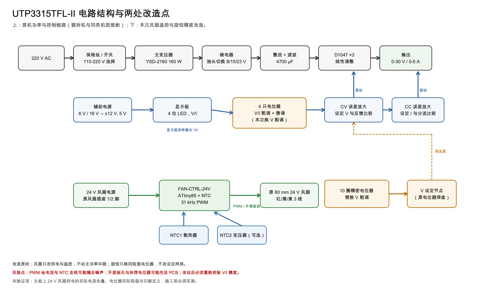
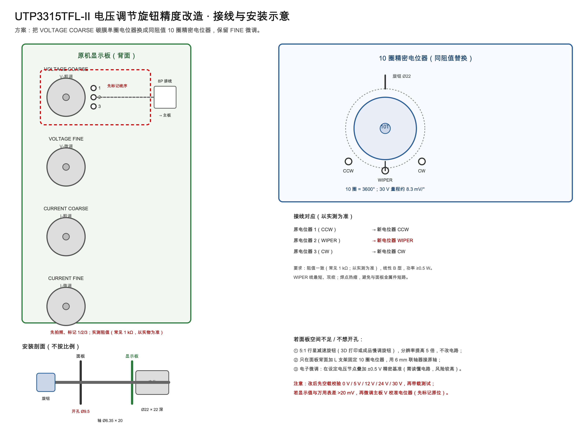

<div align="center">

# UTP3315TFL-II MOD

**把一台“风扇全速、旋钮难调”的线性电源，改成安静、可精确设定的实验台电源。**

NTC 温控风扇 · 10 圈精密电压旋钮 · 可复现的图纸 / BOM / 固件 / 验收流程

[](LICENSE)
[](LICENSE-docs)
[](firmware/fan_ctrl_attiny85.ino)
[](CHANGELOG.md)

[项目介绍](docs/00-introduction.md) · [完整 PDF](docs/utp3315tfl-ii-modification-guide.pdf) · [原理图](hardware/fan-sch-power-mcu.svg) · [BOM](hardware/bom.csv) · [固件](firmware/fan_ctrl_attiny85.ino)

</div>

> [!WARNING]
> 机内有 **220 V 市电** 和 **4700 µF 高压电容**。断电后必须等待并放电；功率管散热器可能带电压。改造会失去保修。没有市电作业经验，请不要自行施工。完整安全事项见 [SAFETY.md](SAFETY.md)。

---

## 这是什么

UNI-T **UTP3315TFL-II** 是一台很典型的入门线性电源：0–30 V / 0–5 A、4 位显示、CV/CC 自动切换，二手和全新价格都不高。但它有两个很影响日常使用的问题：

1. **风扇上电即全速**。原机是 80 mm / 24 V 风扇，6 V 时几乎听不见，24 V 时像小飞机；而它同时还要给变压器散热，不能简单停转。
2. **电压粗调是单圈碳膜电位器**。30 V 只走 270°，约 **111 mV/°**；碳膜磨损后还会跳变。虽然有一路 FINE 微调，实际设定仍然要靠反复“追”。

这个项目把这两处做成**可复现、可测量、可回退**的改造：

- 风扇：NTC 采样 + ATtiny85 + **31.25 kHz PWM**，30 ℃ 以下约 6 V，55 ℃ 以上全速；NTC 故障自动全速。
- 旋钮：用**同阻值 10 圈精密电位器**替换 V-COARSE，分辨率约 **8.3 mV/°**，提高约 13 倍；保留原 FINE。
- 不改主功率环路、不改 CV/CC 反馈、不破坏原风扇与后面板。

## 改造效果（设计目标）

| 项目 | 原机 | 改造后 | 说明 |
|---|---|---|---|
| 风扇低温噪声 | 24 V 全速 | 约 6 V，0.5 m 基本听不见 | 仍保留气流，给变压器散热 |
| 风扇高温散热 | 24 V 全速 | 55 ℃ 以上自动全速 | 双 NTC 取较高温度 |
| 风扇失效安全 | 无 | NTC 断/短 → 全速 | 可选 70 ℃ 温控开关 |
| 电压粗调分辨率 | 约 111 mV/° | 约 8.3 mV/° | 10 圈 = 3600° |
| 电压设定 | 单圈碳膜，易磨损 | 10 圈线绕/导电塑料 | 保留 FINE 微调 |
| 成本 | — | 风扇约 ¥35–45；旋钮约 ¥33–100 | 不含工具 |

> 以上是**设计目标**，不是整机实测值。当前版本尚未汇总批量实测数据；欢迎按 [实测模板](.github/ISSUE_TEMPLATE/measurement.md) 提交你的结果。

## 两处改造一览

### 1. 风扇温控

```
24 V（原风扇插座）─ F1 ─ D1 ─ C1 ─ R17 ─ 78L05 ─ +5 V
                                                │
                                   ATtiny85 ────┤
       NTC1 散热器 ─┐                           │
       NTC2 变压器 ─┴─ 10 kΩ 分压 ─ ADC ────────┤
                                                │
                         PB1 ─ 31 kHz PWM ─ R5 ─ Q1（低边）
                                                │
       +24 V ───────────── 风扇 ────────────────┘
                              │
                         C8 220 µF ∥ D2 SS34
```

- 温度曲线：`T ≤ 30 ℃ → 25%`，`30–55 ℃ 线性 → 100%`，`≥55 ℃ → 100%`。
- 31.25 kHz 超出人耳范围；C8 把 PWM 滤成平滑直流，风扇不会“打嗝”。
- 双 NTC：散热器 + 变压器（可选）；任一路故障只忽略该路，两路都故障才全速。
- 可选 KSD9700 70 ℃ 常开开关跨接在 Q1 漏-源之间，作为独立失效保护。

### 2. 10 圈电压旋钮

- 原 V-COARSE 常见为 **1 kΩ** 碳膜单圈（同系列维修记录；务必实测）。
- 换成同阻值 **10 圈** 电位器：WXD3-13-2W-1K（约 ¥18）或 Bourns 3590S-2-102L（约 ¥75）。
- 三种安装：面板开孔 Ø9.5、L 支架 + 联轴器、5:1 减速旋钮。
- 保留原 FINE；换完按 [验收表](docs/05-build-and-test.md) 重新校验 0/5/12/24/30 V。

## 图纸预览






更多矢量图见 [hardware/](hardware/)；完整接线图见 [fan-wiring.svg](hardware/fan-wiring.svg)。

## 快速开始

1. **先读安全**：[SAFETY.md](SAFETY.md)。断电、放电、确认电容无电压。
2. **实测 5 件事**：风扇电压/电流/针序、电位器阻值与曲线、面板与 PCB 间距。清单见 [docs/05-build-and-test.md](docs/05-build-and-test.md)。
3. **做风扇控制板**：按 [原理图](hardware/fan-sch-power-mcu.svg) 与 [BOM](hardware/bom.csv) 焊接；按 [固件说明](firmware/README.md) 烧录 ATtiny85（8 MHz 内部时钟）。
4. **接线与固定**：按 [机内接线图](hardware/fan-wiring.svg) 接 J1/J2/J3/J4；NTC 贴散热器/变压器。
5. **校验与老化**：按 [施工与验收](docs/05-build-and-test.md) 记录温度—转速、纹波、设定精度。

## 物料概览

| 部分 | 核心料 | 参考价 |
|---|---|---|
| 风扇控制器 | ATtiny85、78L05、AO3400A、SS34 ×2、10 kΩ NTC ×1–2、220 µF/35 V ×2、XH2.54 座 | ¥35–45 |
| 10 圈电位器 | WXD3-13-2W-1K + Ø22 旋钮 + 24 AWG 线 | ¥33 起 |
| 零代码备选 | 24 V NTC PWM 调速模块 + NTC + 转接线 | ¥28 起 |

完整清单（含位号、规格、渠道、替代料）：[docs/04-bom.md](docs/04-bom.md) / [hardware/bom.csv](hardware/bom.csv)。

## 仓库结构

```
.
├── README.md                  ← 你在这里
├── SAFETY.md                  ← 高压安全须知
├── CONTRIBUTING.md            ← 如何提交实测/改进
├── CHANGELOG.md
├── LICENSE                    ← 固件/工具：MIT
├── LICENSE-docs               ← 文档/图纸：CC BY-SA 4.0
├── docs/
│   ├── 00-introduction.md     ← 项目背景与设计取舍
│   ├── 01-research.md         ← 整机调研与电路分析
│   ├── 02-fan-mod.md          ← 风扇温控方案
│   ├── 03-knob-mod.md         ← 旋钮精度方案
│   ├── 04-bom.md              ← 物料清单
│   ├── 05-build-and-test.md   ← 施工、调试、验收
│   ├── 06-appendix.md         ← NTC 表、引脚、来源
│   └── utp3315tfl-ii-modification-guide.pdf
├── hardware/
│   ├── system-block.svg
│   ├── fan-sch-power-mcu.svg
│   ├── fan-sch-ntc-output.svg
│   ├── fan-wiring.svg
│   ├── knob-wiring.svg
│   ├── bom.csv
│   └── previews/              ← PNG 预览
├── firmware/
│   ├── fan_ctrl_attiny85.ino
│   └── README.md
└── tools/                     ← 图纸/PDF 生成脚本
```

## 兼容性与前提

- 主要针对 **UTP3315TFL-II**；同平台的 UTP3313TFL-II（3 A）大概率可参考，但风扇电压、电位器阻值、散热器布局需实测。
- 风扇按 **24 V / ≤0.2 A / 80 mm / 3 线** 设计；若你的机器是 12 V 风扇，固件 `DUTY_MIN` 要改为 96。
- 电位器按 **1 kΩ** 设计；实测 10 kΩ 时把 BOM 换成 10 kΩ 同型号。
- 没有官方图纸：整机拓扑由拆机照片、器件型号与同系列维修记录还原，文中已标注“推断/需实测”。

## 实测数据与项目状态

- **v1.0（当前）**：设计包完成——原理图、BOM、固件、接线、施工与验收流程。
- **待补**：整机风扇电压/电流、V-COARSE 实际阻值、满载温度曲线、改造前后纹波对比、10 圈电位器安装照片。
- 如果你完成了其中任何一项，欢迎提 Issue/PR；模板见 [measurement.md](.github/ISSUE_TEMPLATE/measurement.md)。

## 参与贡献

欢迎三类贡献：

1. **实测数据**：按模板填写，附照片/波形；不必改代码。
2. **硬件改进**：PCB、面板支架、NTC 固定件、12 V 风扇版本。
3. **文档/翻译**：英文 README、错别字、接线图校对。

提交前请先读 [CONTRIBUTING.md](CONTRIBUTING.md)；涉及高压的改动请在 PR 中说明安全验证。

## 许可证

- **固件与工具**（`firmware/`、`tools/`）：[MIT](LICENSE)。
- **文档、图纸与 BOM**（`docs/`、`hardware/`）：[CC BY-SA 4.0](LICENSE-docs)。
- 转载/二次发布请保留来源链接与作者署名；不得暗示优利德官方认可。

## 致谢与参考

本项目的整机信息来自公开资料、拆机照片与同系列维修记录，特别感谢：

- [ph0en1x.net 的拆机与散热改造文章](https://ph0en1x.net/118-regulated-power-supply-uni-t-utp3315tfl-ii-review-and-mod.html)
- [Electronics Repair School 的 UTP3315TFL-II 评测](https://forum.sorinelectronics.com/index.php?topic=2003.0)
- 迅维网两篇维修/拆机帖（电压电位器 1 kΩ、碳膜电位器寿命）
- UNI-T 官方产品页与说明书

完整来源列表见 [docs/06-appendix.md](docs/06-appendix.md)。

## 免责声明

本项目与 UNI-T / 优利德无隶属关系，也未获得官方图纸或授权。按本文施工造成的设备损坏、人身伤害、保修失效或数据损失，由施工者自行承担。高压作业请量力而行；不确定时，只做“成品模块 + 外部接线”的低风险方案，或请专业人士操作。
