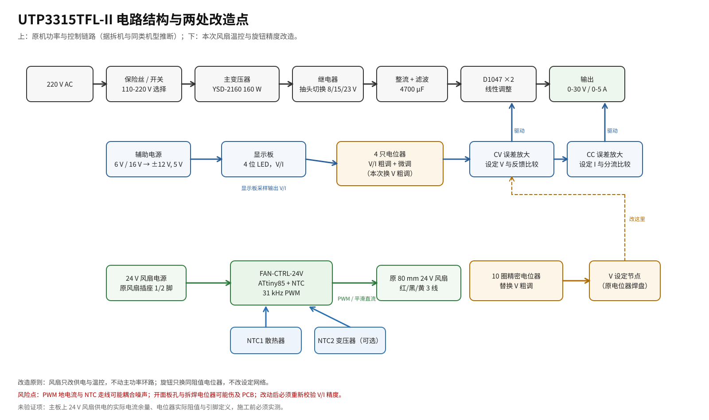

# 01 · 整机调研与电路分析

## 1. 调研方法与边界

优利德没有公开 UTP3315TFL-II 的整机原理图。本文由三类证据交叉还原：

1. **官方资料**：产品页与说明书给出的电气规格、面板功能、保护特性。
2. **拆机照片**：ph0en1x.net 的完整拆机图（功率板正反面、显示板正反面、机内布局）。
3. **同系列维修记录**：迅维网两篇帖子，分别给出“电压电位器 1 kΩ”和“碳膜电位器寿命短”的现场信息。

因此：**外观、器件型号、接线关系是可信的；控制环的具体元件值属于推断**。文中凡推断处均标注“推断”，凡需实测处均标注“需实测”。



## 2. 机型与官方规格

| 项目 | 参数 |
|---|---|
| 型号 | UNI-T UTP3315TFL-II |
| 类型 | 单路、变压器降压、线性稳压 |
| 输出 | 0–30 V / 0–5 A，约 150 W（部分资料写 160 W） |
| 显示 | 4 位 LED，电压 10 mV、电流 1 mA 分辨率 |
| 负载调整率 | 电压 ≤0.01 % + 5 mV；电流 ≤0.1 % + 10 mA |
| 设定精度 | 电压 <0.5 % + 20 mV；电流 <0.5 % + 10 mA |
| 纹波/噪声 | ≤2 mVrms、≤3 mArms |
| 工作模式 | CV/CC 自动切换，短路/过载/反接保护 |
| 输入 | 110 V / 220 V ±5 %，50/60 Hz，机械选择开关 |
| 尺寸/重量 | 105 × 165 × 249 mm，约 4 kg |

官方产品页：<https://uni-trendus.com/products/utp3315tfl-ii>；说明书：<https://en.sekorm.com/doc/2558379.html>。

> 注意：厂商标称“low noise”在包装上配了喇叭图标，实际指的是**低纹波**，不是低风扇噪声。多位用户与评测都提到开箱后风扇全速运转。

## 3. 外部结构

- **前面板**：左侧 4 位电压表（红）与 4 位电流表（绿），中间 C.V / C.C 指示灯；右侧一列 4 只旋钮，从上到下为 `VOLTAGE COARSE`、`VOLTAGE FINE`、`CURRENT COARSE`、`CURRENT FINE`；下方电源按钮与 + / GND / − 输出端子。
- **侧面**：靠近前面板的侧面开有进风阵列；空气从前侧进入，经变压器与散热器，从后部风扇排出。
- **后面板**：80 mm 风扇、110/220 V 选择开关、带保险丝的品字插座。
- **底部**：固定内部组件的螺钉与四个软塑料脚垫。

关键点：**进风口在侧面靠前，风扇在后部抽风**，所以风扇不仅吹散热器，也负责变压器散热。改造时不能把风扇停转，只能降速。

## 4. 内部构造（据拆机照片）

### 4.1 功率变压器

- 型号丝印：`YSD-2160-110/96*45`，约 160 W。
- 一次侧：两组 110 V 绕组（红、黑线），通过后面板 110/220 V 开关串/并联。
- 二次侧：
  - 6 V（蓝线）：辅助电源；
  - 16 V（绿线）：辅助/继电器；
  - 18 V + 18 V（双黄 + 黑）：辅助或风扇；
  - 主功率绕组抽头：0 V（黑）– 8 V（黄）– 21 V（白）– 35 V（绿）。
- 变压器带 70 ℃ 温度保护（评测文章明确提到）。

### 4.2 抽头切换

主板上两只 **JQC-3FF** 继电器（10 A/277 VAC，12 A/125 VAC）用于切换主绕组的抽头。实测/评测给出的切换点约为 **8.2 V、15.2 V、23.2 V** 输出附近，目的是降低调整管上的压差，减少发热。

这解释了使用中会听到的三次“咔哒”声，也说明该机在低压大电流时主要热源是变压器与调整管。

### 4.3 整流、滤波与调整管

- 主整流桥 + **4700 µF** 大电解（照片中体积很大）。
- 两只 **D1047**（SANYO，TO-3PB，NPN，140 V / 12 A / 100 W）并联，安装在一块**较小的立式铝散热器**上；散热器一侧与金属底板相连，借助底板辅助散热。
- 调整管通过一个小板转接，用螺钉压在散热器上，带绝缘垫。
- 主板上还有蓝色 3296 多圈微调电阻，用于电压/电流显示或设定的校准。

### 4.4 控制与显示

- 功率板丝印：`UTP3000TFL-II F 2019.6.6`，说明与 UTP3000TFL 系列共用平台。
- 显示板：两只 **LOD 5641RB-GH** 4 位 LED、一个 16 引脚驱动 IC、4 只碳膜电位器、一个 2×4 排线座。
- **4 只电位器直接焊在显示板上**，长轴穿过前面板；显示板通过 8 芯排线连到功率板。
- 功率板上可见双运放（8 脚）、TO-220 稳压器、线绕分流电阻、整流桥、继电器等。

### 4.5 风扇

- 尺寸：**80 × 80 × 25 mm**（评测正文写“12 cm”，但同文照片与机箱 105 mm 宽度都表明是 80 mm；以实物为准）。
- 电压：**24 V DC**，3 线（红/黑/黄，带测速）。
- 连接：3 针插头插在功率板/转接板上；风扇装在后面板，向外排风。
- 原机控制：**没有温控**，上电即全速。评测实测：6 V 时几乎听不见，9 V 已明显，24 V 像“飞机起飞”。

### 4.6 机内布局

- 左侧（后部）：风扇 + 调整管散热器；
- 中部：主变压器，几乎占满机箱宽度；
- 右侧（前部）：两层 PCB（功率板 + 显示板）、4700 µF、继电器、整流桥；
- 底部：金属底板，兼作散热与屏蔽。

## 5. 电路拓扑分析（推断）

以下为同类线性电源的典型拓扑，结合本机器件与走线推断，**不是官方图纸**。

### 5.1 功率链路

```
220 V → 保险丝/开关/110-220 选择 → 变压器一次侧
     → 主绕组抽头 0/8/21/35 V → 继电器选择 → 整流桥
     → 4700 µF → D1047 ×2（射极跟随/达林顿驱动）→ 输出
```

- 两只 D1047 并联扩流，发射极串联均流电阻（板上可见低阻值电阻）。
- 继电器由输出设定电压比较电路控制，在 8.2/15.2/23.2 V 附近切换抽头。
- 辅助绕组 6 V/16 V 经 7812/7805 产生 ±12 V、5 V，供运放、继电器、显示板。

### 5.2 CV/CC 控制

```
Vref ── Vset 分压（V-COARSE + V-FINE）──→ CV 误差放大器 ─┐
Vout ── 反馈分压 ───────────────────────→               ├─ 二极管或 → 驱动级 → D1047
Iset 分压（I-COARSE + I-FINE）─────────→ CC 误差放大器 ─┘
分流电阻 ── 放大 ──────────────────────→
```

- CV 与 CC 两个误差放大器通过二极管“或”后共同驱动调整管：谁要求更低的输出电压，谁就接管。
- 面板 C.V / C.C 指示灯由两个环路的工作状态点亮。
- 4 只电位器构成两个独立的分压网络：粗调改变大部分行程，微调在小范围内叠加。

> 对改造的意义：**只要不动分压网络与反馈节点，换同阻值电位器是安全的**；反之，任何“数字设定”方案都必须先确认设定节点的阻抗与地参考。

### 5.3 显示

- 电压表：输出端分压 → 双积分/专用 LED 驱动 → 4 位显示。
- 电流表：分流电阻 → 放大 → 4 位显示。
- 显示板与功率板之间是 8 芯排线，包含供电、V/I 模拟量与地。

> 显示板的 16 引脚 IC 与具体引脚定义未在公开资料中出现，本文不依赖它；旋钮改造只动电位器的三根线。

## 6. 已知通病与改造切入点

| 现象 | 证据 | 原因 | 与本文关系 |
|---|---|---|---|
| 风扇常全速、噪声大 | 评测、拆机文章 | 无温控，24 V 直供 | 改造 1 |
| 电压调不到 0 V | 迅维网维修帖 | 碳膜电位器磨损/开路，换 1 kΩ 后恢复 | 改造 2 的直接动机 |
| 旋钮用久后跳变、显示异常 | 迅维网拆机讨论 | 碳膜电位器寿命短、触点氧化 | 改造 2 |
| 散热器偏小、变压器烫 | 拆机文章负载测试 | 机箱小、散热余量有限 | 风扇不能停，只能调速 |
| 继电器在 8.2/15.2/23.2 V 附近动作 | 拆机文章 | 抽头切换降低压差 | 正常现象，不是故障 |

## 7. 改造目标与约束

### 7.1 风扇

- 30 ℃ 以下维持一个“几乎听不见但仍有气流”的最低转速；
- 30–55 ℃ 近似线性升速，55 ℃ 以上全速；
- NTC 断线/短路时自动全速（失效安全）；
- 不引入明显的开关噪声到输出；
- 可逆：保留原风扇与插头，不破坏后面板。

### 7.2 旋钮

- 电压粗调分辨率提高一个数量级；
- 不改变 0–30 V 范围与 CV/CC 行为；
- 保留原有 FINE 微调；
- 机械上可逆或至少不破坏面板。

## 8. 不确定项与实测清单

施工前请逐项记录，填入 [05-build-and-test.md](05-build-and-test.md) 的表格：

1. **风扇**：电压（12/24 V）、电流、尺寸、针序、插头型号。
2. **24 V 电源**：空载/带风扇时的电压，是否受电源开关控制，保险丝/走线余量。
3. **电位器**：每只的阻值（端到端）、引脚定义（1/2/3）、是分压还是变阻器接法。
4. **面板**：原开孔直径、面板到显示板的间距、电位器本体直径与轴长。
5. **温度**：满载 30 min 后散热器与变压器表面温度（红外枪或热电偶）。
6. **输出噪声**：改造前后用示波器 AC 耦合测输出纹波，确认没有变差。

## 9. 参考来源

| 来源 | 提供了什么 | 可信度 |
|---|---|---|
| UNI-T 产品页 <https://uni-trendus.com/products/utp3315tfl-ii> | 规格、尺寸、重量 | 官方 |
| UNI-T 说明书 <https://en.sekorm.com/doc/2558379.html> | 功能、保护、面板说明 | 官方 |
| ph0en1x.net 拆机/散热改造 <https://ph0en1x.net/118-regulated-power-supply-uni-t-utp3315tfl-ii-review-and-mod.html> | 变压器型号/绕组、继电器切换点、D1047、24 V 风扇、6 V 静音、负载温度 | 一手拆机，较高 |
| Electronics Repair School 评测 <https://forum.sorinelectronics.com/index.php?topic=2003.0> | 风扇常全速、四只粗/微调旋钮、散热器偏小 | 一手体验，较高 |
| 迅维网维修帖 <https://www.chinafix.com/forum.php?mod=viewthread&action=printable&tid=1280263> | 电压电位器 1 kΩ、换后恢复 0 V | 维修记录，中等 |
| 迅维网拆机讨论 <https://www.chinafix.com/forum.php?mod=viewthread&action=printable&tid=1113045> | 碳膜电位器寿命短、显示异常 | 用户讨论，中等 |
| elektroda 同型讨论 <https://www.elektroda.pl/rtvforum/topic3657843.html> | 风扇降噪与显示校正（标题） | 未完整读取，仅作旁证 |

> 说明：ph0en1x.net 正文写风扇“12 cm”，但同文照片中的风扇与 105 mm 宽机箱比例明显是 80 mm；本文按 80 mm 设计，并要求施工前实测。
