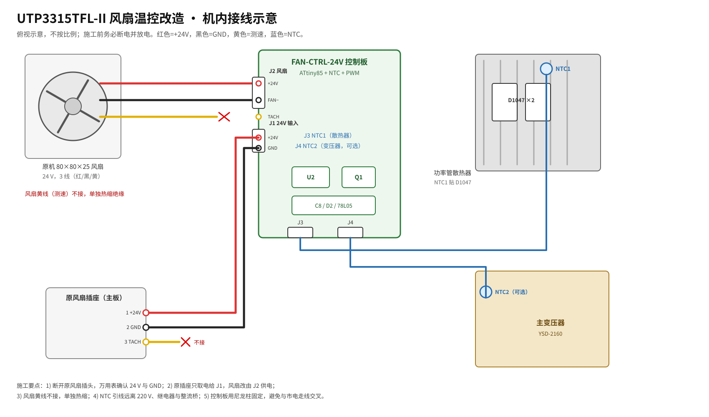

# 02 · 风扇温控改造方案

## 1. 目标

| 指标 | 目标值 |
|---|---|
| 最低转速 | 30 ℃ 以下约 25 % 占空比（24 V 风扇约 6 V），0.5 m 处基本听不见 |
| 升速区间 | 30–55 ℃ 近似线性 |
| 全速 | ≥55 ℃ |
| 失效安全 | NTC 断线/短路 → 全速 |
| 附加噪声 | 输出纹波不增加；无 31 kHz 可闻啸叫 |
| 可逆性 | 保留原风扇、原插头、后面板；控制板可拆 |

## 2. 方案对比

| 方案 | 原理 | 优点 | 缺点 | 适合 |
|---|---|---|---|---|
| A. 成品 24 V NTC 调速模块 | 模块内部 PWM + NTC | 零代码、便宜、接线少 | 曲线不可调、PWM 频率未知、可能啸叫 | 不想焊接 |
| B. **ATtiny85 + NTC + PWM（推荐）** | MCU 采样 NTC，31 kHz PWM 低边开关 | 曲线可调、双 NTC、失效安全、成本低 | 需焊接与烧录 | 本文主方案 |
| C. 线性模拟（运放 + PNP） | NTC 分压 → 运放 → TIP32C 线性调压 | 无开关噪声、线路简单 | 最大耗散约 1.8 W，要加散热片；曲线调整麻烦 | 对 EMI 极敏感 |
| D. 两档开关（6 V/24 V） | 7806 + 切换开关 | 最简单 | 不是“随温度”，仍需手动 | 不推荐 |

选 B 的理由：24 V/0.1 A 的风扇用 PWM 效率高、发热小；31 kHz 超出人耳范围；用 C8 把 PWM 滤成平滑直流，风扇不会“打嗝”。ATtiny85 便宜、DIP-8 好焊、Arduino 生态成熟。

## 3. 系统原理

```
24 V（原风扇插座）── F1 ── D1 ── C1 ── R17 ── 78L05 ── +5 V
                                                   │
                                      ┌────────────┴────────────┐
                                      │        ATtiny85         │
    NTC1（散热器）── 10 kΩ 分压 ── ADC2 │                         │
    NTC2（变压器）── 10 kΩ 分压 ── ADC3 │  PB1 ── 31 kHz PWM ──┐ │
                                      └─────────────────────────┼─┘
                                                                │
                                        R5 100 Ω ── Q1 AO3400A（低边）
                                                                │
    +24 V ────────────────────────────── 风扇 ── Q1 ── GND
                         │              │
                        C8 220 µF      D2 SS34（续流）
```

### 3.1 NTC 分压

采用“NTC 在上、10 kΩ 在下”：

**V_ADC = 5 V × 10 kΩ / (R_NTC + 10 kΩ)**

温度升高 → R_NTC 下降 → ADC 电压升高。10 kΩ、B=3950 的典型值：

| 温度 | R_NTC | V_ADC | 10 位 ADC |
|---|---|---|---|
| 30 ℃ | 8.04 kΩ | 2.77 V | 567 |
| 35 ℃ | 6.56 kΩ | 3.01 V | 616 |
| 40 ℃ | 5.32 kΩ | 3.26 V | 668 |
| 45 ℃ | 4.36 kΩ | 3.48 V | 713 |
| 50 ℃ | 3.60 kΩ | 3.68 V | 753 |
| 55 ℃ | 2.99 kΩ | 3.84 V | 787 |
| 60 ℃ | 2.49 kΩ | 4.00 V | 820 |

分辨率：30 ℃ 附近约 10 个 ADC 码/℃，60 ℃ 附近约 5 个码/℃；8 次平均后约 0.1 ℃，足够。

### 3.2 温度曲线

固件用分段线性：

```
D = 25%                         (T ≤ 30 ℃)
D = 25% + (T-30)/(55-30) × 75%   (30 < T < 55 ℃)
D = 100%                        (T ≥ 55 ℃)
```

对应 24 V 风扇电压：

| 温度 | 30 ℃ | 35 ℃ | 40 ℃ | 45 ℃ | 50 ℃ | 55 ℃ |
|---|---|---|---|---|---|---|
| 占空比 | 25 % | 40 % | 55 % | 70 % | 85 % | 100 % |
| 风扇电压 | 6.0 V | 9.6 V | 13.2 V | 16.8 V | 20.4 V | 24.0 V |

> 曲线可在固件顶部改 `T_START`、`T_FULL`、`DUTY_MIN`。若实测风扇是 12 V，把 `DUTY_MIN` 改为 96（37.5 %，约 4.5 V），否则低占空比可能停转。

### 3.3 PWM 与滤波

- ATtiny85 8 MHz，Timer0 快速 PWM，8 位：f = 8 MHz / 256 = 31.25 kHz，人耳听不到。
- Q1 低边开关，D2 续流，C8 把电流纹波滤成平滑直流。
- 纹波估算：ΔV ≈ I/(fC) = 0.15 A / (31250 Hz × 220 µF) ≈ 22 mV，风扇内部驱动完全可接受。
- 若仍有轻微啸叫，可在 C8 前串 22 µH/1 A 电感（LC 滤波），或把 PWM 频率改为 25 kHz。

### 3.4 电源与功耗

- 24 V 经 F1（0.5 A 自恢复保险丝）、D1（SS34 反接保护）到 C1。
- R17 470 Ω 预降压制：控制器约 10 mA 时压降 4.7 V，78L05 输入约 18.6 V，耗散约 0.14 W；不串 R17 时约 0.19 W，TO-92 也能用，但夏天机内温度高，建议保留。
- 78L05 输出 5 V 给 MCU、LED、NTC 分压；总电流 <15 mA。
- Q1 AO3400A：30 V/5.7 A，R_DS(on) ≈ 28 mΩ，0.2 A 时压降约 6 mV，不需要散热。
- **电压余量**：若实测风扇绕组空载电压 >28 V，Q1 改用 40 V 耐压型号（AO3402、IRLML6344），C8 耐压提到 50 V；否则 30 V 的 Q1 余量偏小。

## 4. 原理图

### 4.1 电源与 MCU


- J1：24 V 输入（来自原风扇插座 1/2 脚）。
- F1 0.5 A、D1 SS34、C1 220 µF/35 V、R17 470 Ω、U1 78L05。
- U2 ATtiny85-20PU：
  - PB1（6 脚）→ PWM；
  - PB2（7 脚）→ NTC_HS（ADC2）；
  - PB3（2 脚）→ NTC_TR（ADC3）；
  - PB0（5 脚）→ 运行 LED；
  - PB4（3 脚）→ 故障 LED；
  - PB5（1 脚）→ RESET/ISP。
- ISP 接线：MOSI=PB0，MISO=PB1，SCK=PB2，RST=PB5，5 V，GND。

### 4.2 NTC 与风扇输出


- NTC1/NTC2 各配 10 kΩ 1 % 下拉与 100 nF 滤波。
- J2：1=+24 V，2=FAN−（Q1 漏极），3=TACH（悬空）。
- D2 跨接在风扇两端，阴极接 +24 V；C8 220 µF/35 V 并联在风扇两端。
- Q1 源极接地，栅极经 R5 100 Ω 接 PWM，R6 10 kΩ 下拉。
- 可选：KSD9700 70 ℃ 常开温控开关跨接在 Q1 漏-源之间；超温时短接 Q1，风扇全速。它不能替代 NTC，只是失效保护。

### 4.3 机内接线



接线表：

| 端点 | 接到 | 线色 | 说明 |
|---|---|---|---|
| 原风扇插座 1 | J1 +24 V | 红 | 万用表确认 |
| 原风扇插座 2 | J1 GND | 黑 | 万用表确认 |
| 原风扇插座 3 | 不接 | 黄 | 热缩绝缘 |
| J2 1 | 风扇红线 | 红 | +24 V |
| J2 2 | 风扇黑线 | 黑 | 开关地 |
| J2 3 | 风扇黄线 | 黄 | 不接，热缩 |
| J3 | NTC1 | 蓝 | 散热器 |
| J4 | NTC2 | 蓝 | 变压器（可选） |

> 若实测主板对风扇测速线有检测（少见，表现为拔掉风扇后报错/亮故障灯），把风扇黄线直接回到主板原针脚，不接控制器。

## 5. 物料

见 [04-bom.md](04-bom.md)。风扇控制器核心料约 ¥35–45。

## 6. 施工步骤

### 6.1 台架测试（不装机）

1. 焊好控制板，检查电源与地无短路。
2. 用可调电源给 J1 供 24 V（限流 0.3 A），空载测 78L05 输出 5.0 V。
3. 接上风扇与 NTC1，烧录固件。
4. 用手捏住 NTC（或吹热风），观察风扇从 6 V 升到 24 V；用示波器/万用表测 J2 两端平均电压。
5. 拔掉 NTC，风扇应全速；短接 NTC，风扇也应全速（固件判故障）。

### 6.2 装机

1. 断电，拔电源线，等待 5 min；用电阻/电压表确认 4700 µF 已放电。
2. 拆底部螺钉，取下上盖；拍照记录原接线。
3. 拔下原风扇 3 针插头。
4. 把 NTC1 固定在 D1047 附近的散热器上：
   - 用 M3 螺钉 + 绝缘粒，或导热硅胶/环氧；
   - 若散热器带电压，必须用绝缘型 NTC 或加绝缘垫；
   - 引线沿机箱边缘走，远离 220 V 与继电器。
5. NTC2（可选）贴在变压器线包侧面，用 Kapton 胶带固定，远离一次侧引线。
6. 控制板用尼龙柱固定在底板空白处，远离市电与整流桥；确认不会碰到风扇叶片。
7. 按接线表接线；所有焊点热缩，导线用扎带固定。
8. 先不装盖，通电测试；确认风扇转向（向外排风）与转速变化。
9. 装盖，做负载老化。

## 7. 调试与验收

### 7.1 温度—转速记录表

| 散热器温度 | 目标占空比 | 实测 J2 平均电压 | 实测转速/听感 |
|---|---|---|---|
| 25 ℃ | 25 % | 5.5–6.5 V |  |
| 35 ℃ | 40 % | 9.0–10.0 V |  |
| 45 ℃ | 70 % | 16.0–17.5 V |  |
| 55 ℃ | 100 % | 23–24 V |  |
| NTC 拔掉 | 100 % | 23–24 V |  |

### 7.2 验收标准

- 25 ℃ 时 0.5 m 处听不到明显风噪，手放风扇后能感到气流。
- 55 ℃ 以上全速；温度回落后 1–2 min 内降速，无来回振荡。
- NTC 断线/短路时全速。
- 输出纹波与改造前相比不增加（示波器 AC 耦合，20 MHz 带宽）。
- 连续 1 A / 5 A 负载 30 min，散热器温度不超过改造前同条件 +5 ℃。
- 无 31 kHz 啸叫；若有，先检查 C8 焊接与风扇共振。

### 7.3 故障排查

| 现象 | 可能原因 | 处理 |
|---|---|---|
| 风扇不转 | 24 V 未到、F1 断、Q1 坏、占空比太低 | 测 J1/J2 电压；把 DUTY_MIN 临时改 128 |
| 风扇常全速 | NTC 开路/短路、ADC 脚虚焊、固件判故障 | 测 NTC 分压；看故障 LED |
| 低速时抖动/停转 | 最小占空比太低、风扇启动转矩不足 | 提高 DUTY_MIN 到 96–128 |
| 有啸叫 | PWM 与风扇共振、C8 失效 | 加 22 µH 电感、换 25 kHz、检查 C8 |
| 输出噪声变大 | PWM 地电流耦合 | 控制板地单点接 J1 GND；NTC 线远离反馈；加 100 nF |
| 烧录失败 | PB2/SCK 被 NTC 分压加载 | 临时拔掉 NTC1 或 R1 再烧 |

## 8. 备选：成品模块

若不想焊接：

- 选“DC 24 V 风扇温控调速器，NTC 10 kΩ，PWM 输出，≥1 A”模块；
- 确认模块 PWM 频率 ≥20 kHz（问卖家或实测），否则可能听到啸叫；
- 模块输出并联 220 µF/35 V 与 SS34 续流；
- NTC 仍按本文位置固定；
- 最小转速用电位器调到风扇能稳定启动。

成品模块的曲线通常不可编程，且廉价模块的 NTC 线性化较差；这是它不如 B 方案的地方。

## 9. 风险

- **市电**：拆机、走线、固定 NTC 时都可能碰到 220 V；断电放电是硬性要求。
- **散热器带电**：D1047 的集电极与散热器之间若有绝缘垫，散热器可能浮空；若绝缘破损，散热器可能带高压。固定 NTC 前先测散热器对地电压。
- **风扇堵转**：低温低占空比时，老化风扇可能不启动；验收时从 0 V 起调，确认能启动。
- **PWM 干扰**：31 kHz 虽不可闻，但仍是开关噪声；控制板地线与 NTC 线要走边缘，不要横穿反馈区。
- **保修**：开盖即失去保修。
