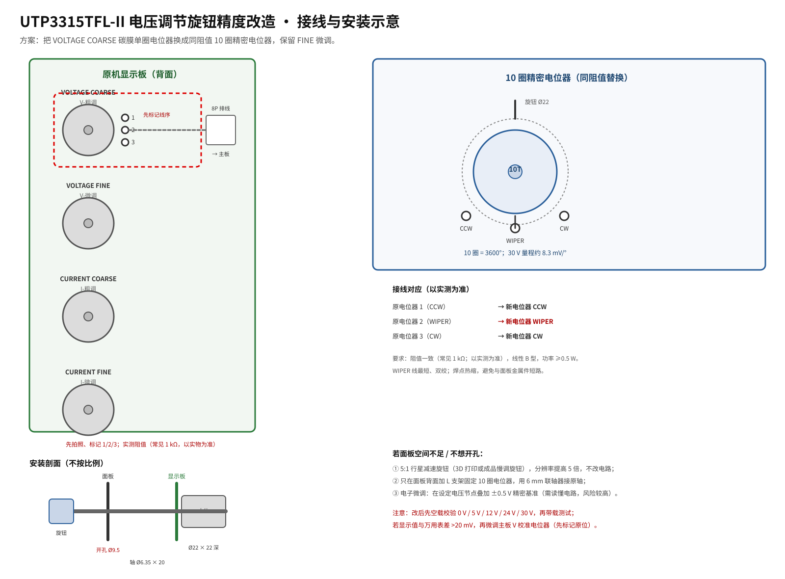

# 03 · 电压旋钮精度改造方案

## 1. 问题量化

原机电压粗调是**单圈碳膜电位器**，机械行程约 270°。30 V 量程下：

**30 V / 270° ≈ 111 mV/°**

22 mm 旋钮的周长约 69 mm，1° 只对应 0.19 mm 的指尖位移；手部微动 0.1 mm 就会让输出跳 50 mV 左右。虽然还有 FINE 微调，但粗调一跳就是几十毫伏，微调要反复“追”，体验很差。

换成 **10 圈电位器**后：

**30 V / 3600° ≈ 8.3 mV/°**

分辨率提高约 **13 倍**；同样 22 mm 旋钮，指尖 0.1 mm 只改变约 4 mV。保留原 FINE 后，可以轻松设到 10 mV 以内。

## 2. 根因

| 因素 | 说明 |
|---|---|
| 单圈行程短 | 270° 覆盖 30 V，必然“一扭就过” |
| 碳膜电位器磨损 | 触点氧化/磨损后阻值跳变，输出抖动；维修帖中“调不到 0 V，换 1 kΩ 电位器解决”就是典型 |
| 粗调/微调配合不好 | 粗调跳变太大，微调范围有限，二者互相“打架” |
| 旋钮直径小 | 原旋钮约 13–16 mm，力臂短，进一步放大手抖 |

## 3. 方案对比

| 方案 | 做法 | 分辨率提升 | 改动量 | 风险 | 评价 |
|---|---|---|---|---|---|
| **A. 10 圈电位器（推荐）** | 同阻值 10 圈精密电位器替换 V-COARSE | ~13× | 拆焊 3 根线、开孔或支架 | 机械空间、阻值选错 | 效果最好，成本适中 |
| B. 5:1 减速旋钮 | 原电位器不动，套行星减速旋钮 | 5× | 几乎为零 | 回差、同心度 | 最省事，适合不想动烙铁 |
| C. 电子微调 | 在设定节点叠加 ±0.5 V 精密基准 | 可做到 1 mV | 需找节点、加板 | 环路稳定性、地噪声 | 进阶，需读懂电路 |
| D. 数字设定 | 编码器 + MCU + DAC 替代电位器 | 1 mV | 最大 | 浮地、隔离、校准 | 不建议作为第一次改造 |

**推荐 A**；如果面板空间不够，用 **B** 作为退路；C/D 只在你能独立完成环路分析时考虑。

## 4. 阻值与引脚确认（施工前必做）

同系列维修记录给出电压电位器为 **1 kΩ**，但不同批次可能不同。步骤：

1. 断电、拔电源线、放电。
2. 拆下显示板（或至少让电位器引脚可触及）。
3. 拍照记录 4 只电位器的位置与线序。
4. 用万用表测**端到端电阻**：
   - 若在路测量受并联电路影响，挑开一端再测；
   - 记录 1–3 脚之间的阻值，判断是 3 端分压还是 2 端变阻器接法。
5. 常见结果：1 kΩ 或 10 kΩ，线性 B 型。
6. **判断曲线**：把电位器转到 50 % 角度，测 WIPER 到一端；若约为额定值一半，是 B 型线性；明显偏大/偏小则是 A/C 型，替换必须同曲线。
7. 新电位器**阻值必须一致**（±5 %），否则 0–30 V 范围会变。

> 若实测是 10 kΩ，把 BOM 中的 1 kΩ 型号换成 10 kΩ（如 3590S-2-103L、WXD3-13-2W-10K）。

## 5. 接线



### 5.1 三端接法（最常见）

| 原电位器 | 新 10 圈电位器 | 说明 |
|---|---|---|
| 1（CCW） | CCW | 逆时针端 |
| 2（WIPER） | WIPER | 中间抽头，最关键 |
| 3（CW） | CW | 顺时针端 |

- 用 24 AWG 硅胶线，长度 12–15 cm；
- WIPER 线与地线双绞，减少干扰；
- 焊点套热缩管；
- 新电位器外壳若与面板金属接触，确认没有与 WIPER/端脚短路。

### 5.2 两端接法（变阻器）

如果原电路只用了两端（一端 + WIPER），新电位器同样只接这两端，另一端悬空并绝缘。不要“想当然”把第三端接地，否则会改变分压比。

### 5.3 上电前检查

- 用万用表测新电位器：顺时针旋转，WIPER 与 CW 之间电阻应从 0 平滑增加到额定值；
- 确认没有短路、没有装反；
- 先不接负载，空载上电，测 0–30 V 是否连续可调。

## 6. 机械安装

### 6.1 方案 M1：面板安装（推荐给 3590S）

1. 测原开孔：常见 7 mm；3590S 需要 **Ø9.5 mm**。
2. 用阶梯钻/铰刀扩孔，边钻边吸屑；不要用普通麻花钻硬扩，容易把面板撕变形。
3. 电位器装到面板，调整角度，使 0–10 圈刻度朝上。
4. 三个引脚用飞线接到显示板原焊盘。
5. 装 22 mm 旋钮（6.35 mm 轴，紧定螺钉）。

注意深度：3590S 本体约 22 mm，轴 20 mm；显示板在面板后约 5–10 mm。若本体与 PCB 干涉，改用 M2。

### 6.2 方案 M2：L 支架 + 联轴器（不开大孔）

1. 保留原 7 mm 面板孔。
2. 在面板背面固定一个小 L 铝支架，把 10 圈电位器固定在支架上。
3. 用 6 mm 弹性联轴器连接原轴/新轴；轴穿过原孔。
4. 飞线到显示板。
5. 优点：面板不扩孔；缺点：需要支架与联轴器，轴向长度要算准。

### 6.3 方案 M3：5:1 减速旋钮（不动电路）

- 买成品“慢调旋钮/行星减速旋钮”，或 3D 打印一个 5:1 减速套件；
- 直接套在原 6 mm 花键轴上；
- 分辨率提高 5 倍，回差通常 0.5–1°；
- 适合不想拆焊的人。

## 7. 校准

> 换电位器后，设定分压比可能有 1–2 % 的偏差，**必须重新校验**。

1. 空载，输出接万用表（4.5 位以上）。
2. 逆时针到底，确认输出 0.00 V；若不能到 0，检查新电位器 CCW 端是否接对。
3. 依次设 5.00 V、12.00 V、24.00 V、30.00 V：
   - 用粗调靠近，再用 FINE 微调；
   - 记录“显示值”与“万用表值”。
4. 若显示值与万用表差 >20 mV：
   - 找到功率板上的 **V 校准微调电阻**（蓝色 3296，先拍照标记原位）；
   - 小幅调整，使显示跟踪万用表；
   - 不要动 I 校准。
5. 带载 1 A，重复 12 V/24 V 两点，确认负载调整率没有变差。
6. 短路测试：设 1 A 限流，短接输出，确认 CC 灯亮、电流稳定。

## 8. 验收标准

| 项目 | 标准 |
|---|---|
| 0 V | 显示 0.00 V，万用表 <10 mV |
| 12.00 V | 误差 ≤20 mV |
| 24.00 V | 误差 ≤30 mV |
| 30.00 V | 误差 ≤40 mV |
| 回程 | 从 30 V 回到 0 V，无卡死、无跳变 |
| 敲击 | 轻敲旋钮/面板，输出跳变 <20 mV |
| 漂移 | 预热 10 min 后，10 min 内漂移 <10 mV |
| FINE | 原微调仍有效，范围没有明显变化 |
| CC | 0.5 A/1 A 限流正常 |

## 9. 高级方案：数字设定（不推荐首次改造）

若你坚持用编码器 + DAC：

```
编码器 → MCU → DAC（0–5 V）→ 继电器切换 → 原 WIPER 节点
                                   ↑
                            原电位器（保留，作为备份）
```

必须满足：

1. **先断开原电位器 WIPER**，否则 DAC 与电位器打架；
2. DAC 输出阻抗要低，或加运放缓冲；
3. 控制板必须**与电源输出共地**，但不能通过 USB/调试器引入大地环路；
4. 上电顺序、断电保持、DAC 复位到 0 V 都要设计；
5. 先验证 CV 环路在“外部强制设定电压”下仍稳定，再接负载。

风险：浮地、地环路、DAC 噪声、环路失稳。没有示波器和环路经验，不要做。

## 10. 风险与注意

- **拆焊伤 PCB**：显示板是单面板/薄板，焊盘小；用吸锡带 + 低温焊锡，不要硬拽。
- **开孔伤面板**：先小孔后铰刀，注意不要划伤显示窗。
- **阻值选错**：10 kΩ 装到 1 kΩ 位置，0–30 V 范围会明显变小/变大。
- **装反**：CCW/CW 反了会导致顺时针降压；上电前用万用表确认。
- **保修**：开盖即失去保修。
